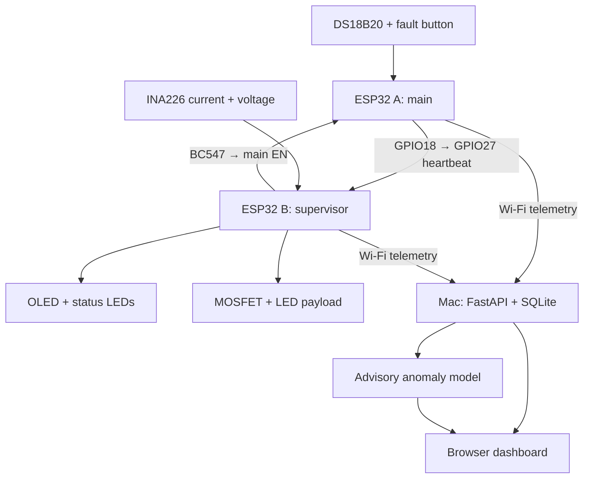
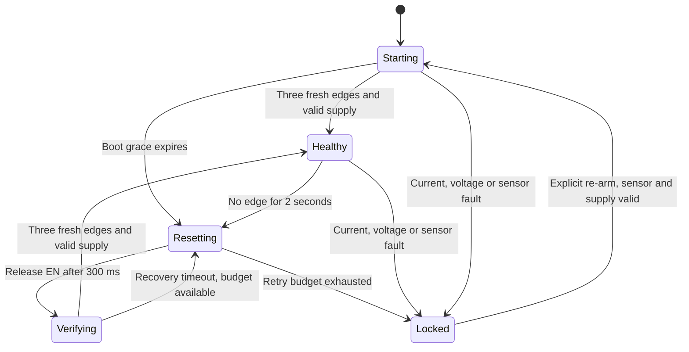

# Architecture and behavior

## Data and control paths



Both ESP32s use their own USB power and their grounds are common. The boards' 3V3 regulator outputs are not joined. The Mac is a telemetry viewer and command source; it is not part of B's heartbeat/reset timing loop.

Heartbeat here means electrical liveness pulses from the main controller; no human pulse sensor is involved.

## Main behavior

- GPIO18 changes state every 250 ms: four edges per second, a 2 Hz square wave.
- A LOW on the debounced GPIO25 button latches the injected freeze fault until reset.
- The DS18B20 uses 10-bit conversions. Conversion is asynchronous; the heartbeat loop keeps running.
- Real temperature ≥45 °C sets thermal fault; a temperature ≤40 °C clears its hysteresis state. While a fault is active, heartbeat is held LOW.
- Heartbeat starts only after a valid probe reading. At each boot, the first reading must be at or below 40 °C to clear the thermal block; this prevents a reset from bypassing the release temperature.
- A missing/disconnected probe becomes a fault after the five-second boot grace. No made-up temperature replaces a missing reading.
- `freeze` and `test_thermal` commands are software injections. They leave actual sensor measurements unchanged in hardware mode.
- Real or injected faults stop heartbeat. B sees the missing edges and handles the reset. A's fault cause reaches the dashboard over Wi-Fi when A remains able to report it.

## Supervisor state machine



- The payload is off in Starting, Resetting, Verifying and Locked states.
- The payload is enabled in Healthy only if heartbeat is fresh, the current sensor is available and the user has not manually disabled it.
- Three reset attempts (including manual reset requests) are permitted per retry budget. Brief heartbeat recovery does not clear the budget; 60 seconds of uninterrupted Healthy operation clears it.
- Overcurrent (>30 mA magnitude) and undervoltage (<2.70 V) require five consecutive 200 ms samples. They latch protection for manual inspection and re-arm.
- INA226 disappearance latches protection immediately on detection. On Re-arm, the firmware attempts to initialize the sensor again.
- Reset Main cannot bypass a latched protection fault. Re-arm requires a responding sensor and sufficient voltage, then still waits for new heartbeat edges. A persistent current fault will re-trip after the payload is re-enabled.
- The first latched fault is retained until re-arm. Command acknowledgement means the controller processed the request; it does not mean a safety condition permitted the requested output change.
- Red LED = protection/startup/recovery state. Green LED = Healthy; the green LED can remain on when the payload is deliberately disabled by the user.
- GPIO32 HIGH turns the NPN transistor on and pulls A EN LOW. GPIO32 LOW releases the reset transistor. Output pull-down resistors keep transistor/gate controls off during supervisor boot.

The supervisor policy is in `firmware/include/supervisor_logic.h`; native tests exercise that exact header. Electrical sampling, interrupt capture and GPIO output still require verification on the physical boards.

## Advisory ML layer

The FastAPI process collects a baseline only while both boards report fresh healthy states, the probe and INA226 are present, heartbeat is valid and the payload is enabled. It requires 60 readings (about one minute), then fits an Isolation Forest on the real measurements; it refits after each 30 additional healthy samples. The displayed anomaly score combines the negated signed distance from the classifier boundary with a four-standard-deviation guard for values outside the training range; it is not a probability.

The model can flag unusual temperature/voltage/current combinations in the dashboard and API. It never commands a shutdown, reset or re-arm. Firmware thresholds and heartbeat recovery remain the only automatic protection path. Faulted readings are not added to the healthy baseline. Simulation mode learns only from clearly labelled simulator telemetry. The model is in-memory and relearns after a server restart.

## Wi-Fi and commands

Network operations run on a separate FreeRTOS task pinned to core 0; application loops use the Arduino loop task. Telemetry snapshots pass through a length-one queue, so the newest state replaces old unsent readings. Commands use a queue and IDs; network delay does not hold the heartbeat loop.

Every report includes a random per-boot ID, a sequence number, uptime, status, fault and last processed command ID. On HTTP success, the server replies with either a pending command or `null`. A pending command stays available until acknowledged or expired. A device avoids delivering the same ID twice within that boot. This is a local demo protocol, not a transactional flight command link: power loss exactly during command execution can make its final outcome uncertain; inspect the reported hardware state.

The server rejects stale sequence numbers within a boot and rejects real-device ingestion in Simulation mode. It marks a device offline after six seconds without a newly accepted report. A stale value may remain visible for diagnosis, but its metric is labelled Stale and its controller Offline.

Hardware trip thresholds are in `firmware/include/config.h`. The dashboard's threshold labels and `THRESHOLDS` in `main.py` match the defaults; update those too if you change firmware thresholds.

## API

| Method / path | Purpose | Key required |
|---|---|---|
| GET `/` | Dashboard | No |
| GET `/api/health` | Server state | No |
| GET `/api/telemetry` or `/telemetry` | Current combined view | No |
| POST `/api/devices/main/telemetry` | Main report | Yes |
| POST `/api/devices/supervisor/telemetry` | Supervisor report | Yes |
| POST `/api/commands` | Queue a validated device command | Yes |
| GET `/api/commands` | Recent delivery/acknowledgement states | No |
| GET `/api/events` | Recent events | No |
| GET `/api/ml/status` | Advisory model readiness and current score | No |
| GET `/api/history?limit=240` | Recent stored device samples | No |
| GET `/api/export.csv` | Latest 10,000 stored sample rows | No |
| POST `/api/chat` | Deterministic telemetry/event answer | No |
| WebSocket `/ws/telemetry` | Combined updates about twice per second | No |
| GET `/docs` | Interactive API schema | No |

Use header `X-ASTRA-Key` for protected operations. Only one pending command per device is allowed. Commands expire after 20 seconds and pending commands expire on server restart. SQLite events survive restart; active controller freshness starts from waiting until new reports arrive. Stored samples are throttled to at most one per second per board and periodically bounded to approximately 100,000 rows; events to approximately 5,000. Temporary excess between pruning passes is expected.

Example command body:

```json
{"device":"main","action":"freeze"}
```

Allowed main actions: `freeze`, `test_thermal`. Allowed supervisor actions: `payload_on`, `payload_off`, `reset_main`, `rearm`, `test_current`, `test_voltage`.

## Component documentation

- [PlatformIO ESP32 Dev Module](https://docs.platformio.org/en/stable/boards/espressif32/esp32dev.html)
- [Espressif FreeRTOS tasks](https://docs.espressif.com/projects/esp-idf/en/stable/esp32/api-reference/system/freertos_idf.html)
- [TI INA226 datasheet](https://www.ti.com/lit/ds/symlink/ina226.pdf) — local register driver in firmware/include/ina226_sensor.h
- [DallasTemperature library](https://github.com/milesburton/Arduino-Temperature-Control-Library)
- [Adafruit SSD1306 library](https://github.com/adafruit/Adafruit_SSD1306)
